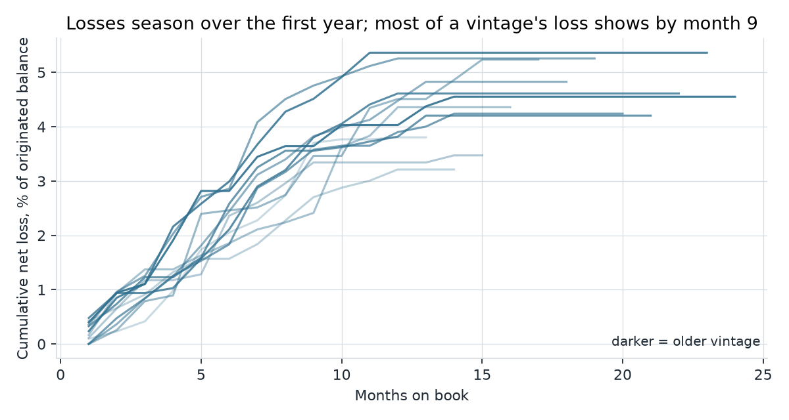
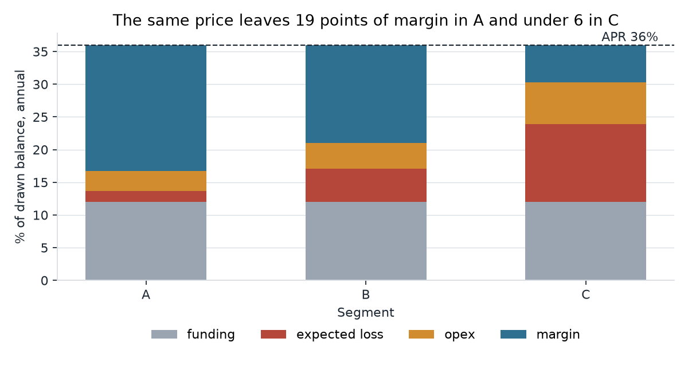
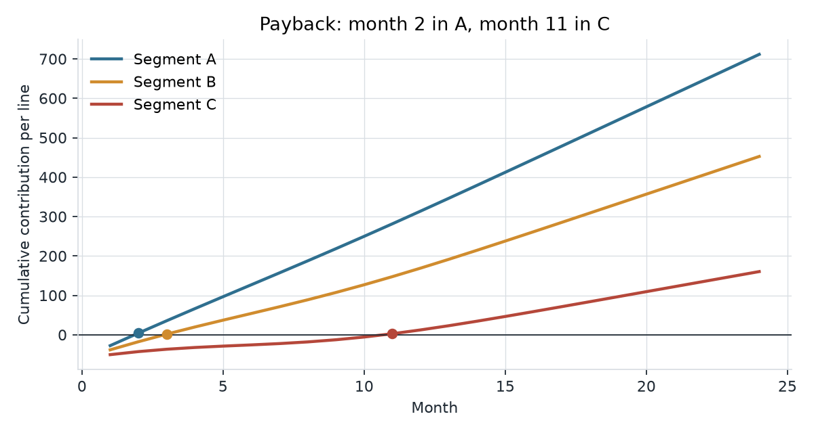

# lending-unit-economics

Unit economics of a revolving consumer credit line on a synthetic portfolio:
how losses season by cohort, expected loss by risk segment, whether the price
covers the cost stack, what one line earns and when it pays back, and how
sensitive that is to the loss rate, the interest rate and the limit.

`analysis.ipynb` runs the analysis; `unit_economics/` holds the arithmetic.
pandas, numpy and matplotlib only.

## Questions the notebook answers

1. When is most of a vintage's loss visible?
2. What is the expected loss per line in each segment?
3. Does one price cover funding, expected loss and opex in every segment?
4. What does a line earn over 24 months, and when does it pay back its acquisition cost?
5. How does per-line contribution move with loss rate, interest rate and limit?

## Main charts

**Cohort loss curves.** Twelve monthly vintages, cumulative net loss as a share of
originated balance. Most of a vintage's loss shows by month 9; reading a cohort at
month 3 understates it by more than half.



**Price against the cost stack.** Annual rates on drawn balance. The same price
leaves 19 points of margin in the low-risk segment and under 6 in the high-risk one.



**Payback per line.** Cumulative expected contribution of an average line, with
the acquisition cost paid in month 1.



**Sensitivity.** Contribution per line over 24 months, generic currency units,
utilisation 55%.

| Annual loss rate | APR | Limit 1,000 | Limit 2,500 | Limit 5,000 |
| ---: | ---: | ---: | ---: | ---: |
| 2% | 24% | 11 | 188 | 483 |
| 2% | 36% | 141 | 512 | 1,132 |
| 2% | 48% | 270 | 836 | 1,780 |
| 5% | 24% | -8 | 139 | 384 |
| 5% | 36% | 118 | 454 | 1,015 |
| 5% | 48% | 244 | 770 | 1,646 |
| 8% | 24% | -26 | 91 | 287 |
| 8% | 36% | 97 | 398 | 901 |
| 8% | 48% | 219 | 705 | 1,516 |
| 12% | 24% | -50 | 30 | 163 |
| 12% | 36% | 69 | 326 | 756 |
| 12% | 48% | 187 | 623 | 1,349 |

Small lines are where the economics break: the acquisition cost is fixed and the
balance is not.

## Model

- Three risk segments with their own 12-month default probability, limit and
  utilisation. Defaults season over the first year (peak around month 6).
- Expected loss = PD × LGD × EAD, with EAD as the average drawn balance.
- Per line and month: interest revenue on the surviving balance, funding cost,
  expected losses, servicing cost; acquisition cost in month 1.
- No prepayment, no limit changes, constant balance until default, no fees.

## Run

```
pip install pandas numpy matplotlib jupyter pytest
jupyter notebook analysis.ipynb
python -m pytest
```

## Parameters are illustrative

Every rate, cost, limit and default probability in `unit_economics/params.py`
is invented to make the mechanics visible. None describes a real product,
lender or portfolio.

Written with AI-assisted development; the modelling choices, review and tests are mine.

MIT license.
